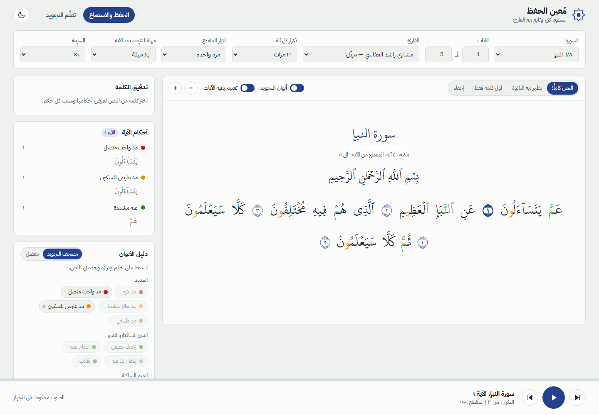

<div dir="rtl">

# مُعين الحفظ — Quran Hifz & Tajweed

موقع يعمل على جهازك لمساعدتك على حفظ القرآن الكريم **بالاستماع والمتابعة**، ولتعلّم أحكام التجويد.

- **في قسم الحفظ:** تختار السورة والآيات والقارئ، فتسمع كل آية بالعدد الذي تريده، وتُضاء في النص الكلمة التي يقرؤها القارئ لحظة بلحظة. وتظهر أحكام التجويد ملوّنة، ومع كل حكم سببه في هذه الكلمة بالذات.
- **في قسم التعلّم:** ٣٤ درسًا في أحكام التجويد، تسمع أمثلتها بصوت القارئ نفسه كلمةً بكلمة، وفي آخر كل درس اختبار، ومعها متنا تحفة الأطفال والجزرية.

> المشروع للاستماع والتتبع والتعلّم فقط، ولا يسجّل صوتك ولا يكشف أخطاء التلاوة.



---

## المحتويات

- [المزايا](#المزايا)
- [لقطات](#لقطات)
- [التشغيل السريع](#التشغيل-السريع)
- [العمل دون اتصال](#العمل-دون-اتصال)
- [كيف يعمل](#كيف-يعمل)
- [واجهة البرمجة API](#واجهة-البرمجة-api)
- [الإعدادات](#الإعدادات)
- [بنية المشروع](#بنية-المشروع)
- [الاختبارات](#الاختبارات)
- [الاستضافة](#الاستضافة)
- [المصادر والتراخيص](#المصادر-والتراخيص)
- [خطط مستقبلية](#خطط-مستقبلية)
- [English summary](#english-summary)

---

## المزايا

### ١. الحفظ والاستماع

| الميزة | التفاصيل |
|---|---|
| اختيار المقطع | أي سورة من السور الـ١١٤، من آية إلى آية |
| ١٤ قارئًا | منهم الحصري (مرتّل ومعلّم)، والمنشاوي (مرتّل، ومعلّم مع ترديد الأطفال)، والعفاسي، وعبد الباسط (مرتّل ومجوّد)، والسديس، والشريم، والدوسري |
| تكرار الآية | من مرة إلى ١٠ مرات، أو بلا توقف |
| تكرار المقطع | تكرار المقطع كاملًا بعدد محدد أو بلا توقف |
| مهلة للترديد | توقّف بعد كل آية لتردد خلف القارئ: ثانيتان، أو ٤ ثوانٍ، أو بطول الآية، أو مرة ونصف طولها، مع عدّاد دائري |
| السرعة | من ٠٫٦ إلى ١٫٣ دون تغيّر طبقة الصوت |
| تتبع القارئ | إضاءة الكلمة المقروءة لحظيًا، وتحريك النص معها تلقائيًا، وتعتيم بقية الآيات |
| التنقل بالنقر | نقرتان على كلمة تبدأ التلاوة منها، والنقر على رقم الآية يبدأ من أولها، وشريط التقدم يتيح التقديم داخل الآية |
| أوضاع الحفظ | النص كاملًا، أو يظهر مع التلاوة، أو أول كلمة من كل آية، أو إخفاء كامل لاختبار نفسك |
| صوت الكلمة | الاستماع لنطق كلمة منفردة |
| حفظ الإعدادات | يتذكر الموقع آخر سورة ومقطع وقارئ وإعدادات |
| الوضع الليلي | فاتح وداكن، ويتبع إعداد النظام تلقائيًا |

### ٢. أحكام التجويد في النص

- **١٧ حكمًا ملوّنًا** بنظامين للألوان:
  - **مصحف التجويد:** ألوان دار المعرفة المعروفة.
  - **مفصّل:** لون مستقل لكل حكم.
- **تدقيق الكلمة:** عند الضغط على أي كلمة تظهر أحكامها كلها، ولكل حكم:
  - الحرف الذي سببه وشرح السبب، مثل: «نون ساكنة بعدها «ف» ← إخفاء حقيقي».
  - المقدار بالحركات.
  - تعريف الحكم.
  - الأبيات التي تنص عليه من تحفة الأطفال أو الجزرية.
  - رابط درسه.
- **علامات الوقف** في الكلمة ومعانيها: صلى، قلى، م، لا، ج، ∴.
- **أحكام الآية:** ملخص الأحكام في الآية الحالية مع الكلمات التي فيها كل حكم.
- **إبراز حكم واحد:** الضغط على حكم في دليل الألوان يُبرز مواضعه وحدها في النص.

### ٣. تعلّم التجويد

| القسم | المحتوى |
|---|---|
| الدروس | ٣٤ درسًا في ١١ وحدة على رواية حفص عن عاصم من طريق الشاطبية، من الأسهل إلى الأصعب |
| محتوى كل درس | القاعدة، والحروف، وأمثلة ملوّنة، والأخطاء الشائعة وتصحيحها، ومقارنات بين الأحكام، واختبار في آخره |
| الأمثلة المسموعة | كل مثال يُسمَع **بكلماته فقط** من تلاوة القارئ الذي تختاره، وأي آية في الدرس تُسمَع كاملة |
| الشرح المرئي | ٢٦ مقطع شرح لعلماء التجويد. لكل مقطع زرّان: «افتح في YouTube» ويعمل دائمًا، و«شاهد هنا» لتشغيله داخل الصفحة. وقد يطلب YouTube تسجيل الدخول عند التشغيل داخل الصفحة، وهذا قراره ولا يمكن للموقع تجاوزه |
| تدريب شامل | ١٠ أسئلة عشوائية من بنك فيه ١٠٦ أسئلة، مع سبب كل إجابة ورابط درسها |
| خلاصة الأحكام | جداول للمراجعة السريعة |
| المتون | تحفة الأطفال (٦١ بيتًا) والمقدمة الجزرية (١٠٨ أبيات) بترقيم الأبيات |
| متابعة التقدم | يُحفظ ما أتممته من الدروس على جهازك |

### اختصارات لوحة المفاتيح (في صفحة الحفظ)

| المفتاح | الوظيفة |
|---|---|
| مسافة | تشغيل / إيقاف |
| السهم الأيسر | الآية التالية |
| السهم الأيمن | الآية السابقة |
| `T` | تشغيل / إطفاء ألوان التجويد |
| `R` | تكرار الآية بلا توقف / مرة واحدة |
| Enter على كلمة | تدقيق الكلمة |

---

## لقطات

| الحفظ (داكن) | دروس التجويد |
|---|---|
|  |  |
| **درس الإخفاء الحقيقي** | **المتون** |
|  |  |

---

## التشغيل السريع

**المتطلبات:** Python 3.10 أو أحدث، واتصال بالإنترنت عند أول استخدام لكل سورة وقارئ. **لا يحتاج إلى GPU.**

### Windows

```bash
run.bat
```

### Linux / macOS

```bash
sh run.sh
```

### يدويًا

```bash
cd backend
python -m venv .venv
.venv\Scripts\activate          # على Linux/macOS: source .venv/bin/activate
pip install -r requirements.txt
python -m uvicorn app.main:app --host 127.0.0.1 --port 8000
```

ثم افتح <http://127.0.0.1:8000>.

- الخادم نفسه يقدّم الواجهة، فلا حاجة لخادم آخر.
- قسم التعلّم على <http://127.0.0.1:8000/#/learn>.

---

## العمل دون اتصال

يُحفظ كل ما يُجلب في `backend/cache/`، ثم يعمل دون اتصال:

- **النص وأحكام التجويد:** يُحفظان عند أول فتح لكل سورة (المصحف كاملًا نحو ٣٠ MB).
- **التوقيتات:** تُحفظ عند أول استخدام لكل قارئ وسورة.
- **صوت السورة:** يُحفظ في الخلفية عند أول استماع، ويظهر أسفل المشغّل «الصوت محفوظ على الجهاز».

لتجهيز كل شيء مسبقًا:

```bash
cd backend
python scripts/prefetch.py                          # نص المصحف كاملًا وأحكامه
python scripts/prefetch.py --reciter 7 --surahs 78-114   # + توقيت وصوت جزء عمّ للعفاسي
```

أرقام القرّاء من `GET /api/reciters`، ومنها:

| الرقم | القارئ |
|---|---|
| 6 | الحصري، مرتّل |
| 12 | الحصري، معلّم |
| 9 | المنشاوي، مرتّل |
| 168 | المنشاوي، معلّم مع ترديد الأطفال |
| 7 | العفاسي |
| 2 | عبد الباسط، مرتّل |

> أمثلة الدروس لا تحفظ صوت السورة كاملة؛ فتسجيل البقرة بصوت الحصري المعلّم مثلًا يبلغ مئات الميغابايت. تُبَثّ الأمثلة بثًّا، إلا إن كان صوت السورة محفوظًا من قبل.

---

## كيف يعمل

```
┌──────────────── المتصفح (JavaScript بلا أدوات بناء) ────────────────┐
│ player.js   محرك التكرار والتتبع (ملف صوت واحد للسورة)               │
│ view.js     عرض النص، إضاءة الكلمة، أوضاع الحفظ                       │
│ tajweed.js  دليل الألوان، تدقيق الكلمة، أحكام الآية، الشواهد           │
│ learn.js    الدروس، التدريب، الخلاصة، المتون                           │
│ clip.js     تشغيل مقطع دقيق (كلمات أو آية) من تلاوة القارئ             │
└──────────────┬──────────────────────────────────────────────────────┘
               │ /api/*                      data/learn/*.json (ملفات ثابتة)
┌──────────────▼──────────── FastAPI ─────────────────────────────────┐
│ quran_api.py      يجلب النص وترميز التجويد ويحوّلهما إلى بنية جاهزة   │
│ tajweed_audit.py  يحلّل الترميز ويستنتج سبب كل حكم                    │
│ audio_service.py  القرّاء، توقيت الكلمات، حفظ الصوت (يدعم Range)      │
│ cache.py          تخزين JSON على القرص + عميل HTTP مشترك              │
└──────────────┬──────────────────────────────────────────────────────┘
               ▼
   Quran.com API v4 (النص والتجويد)  ·  QDC (الصوت وتوقيت الكلمات)
```

### تتبع القارئ

- **مصدر التوقيت:** لكل قارئ ملف توقيت من Quran.com (QDC) فيه بداية كل كلمة ونهايتها بالمللي ثانية، بصيغة `[[word_pos, start_ms, end_ms], ...]`. هذه التوقيتات ناتجة عن محاذاة قسرية (forced alignment) مُراجَعة.
- **تنظيف البيانات:** يحذف الخادم المدخلات المعطوبة، مثل `[1]`، وأي مدخل نهايته قبل بدايته.
- **تحديد الكلمة الحالية:** يشغّل `player.js` ملف السورة الواحد، ويحدد الكلمة الحالية بالبحث الثنائي في كل إطار رسم.
- **تكرار الكلمات:** إذا كرّر القارئ كلمات، كترديد الأطفال، تُضاء الكلمة كلما قُرئت.

**لماذا لا يُشغَّل نموذج ذكاء اصطناعي محليًا؟** نموذج المحاذاة في المشروع المرجعي (`obadx/muaalem`) يحتاج نحو ٥ GB وبطاقة رسوميات لكل طلب. أما التوقيتات الجاهزة فدقيقة وفورية، وتعمل على أي جهاز.

### محرك التكرار

عند نهاية كل آية يقرر المحرك واحدًا من:

1. **إعادة الآية:** إن بقي من عدد تكرارها شيء.
2. **الانتقال للآية التالية:** دون قطع إن كانت ملاصقة لها في التسجيل.
3. **العودة إلى أول المقطع:** في الدورة التالية.
4. **التوقف:** إن انتهى كل التكرار المطلوب.

وتُدرج المهلة بعد كل قراءة إن كانت مفعّلة. ويستمر التكرار حتى لو كانت نافذة المتصفح في الخلفية.

### تدقيق أحكام التجويد

يرمّز Quran.com كل كلمة هكذا:

```html
يُ<rule class=ikhafa>نف</rule>ِق<rule class=madda_permissible>ُو</rule>نَ
```

يعمل `tajweed_audit.py` على هذا الترميز في خطوتين:

1. **التحليل الآمن:** يحوّله إلى أجزاء منظمة `[{"t": نص, "r": حكم}]`. أسماء الأحكام من قائمة مسموحة فقط، والواجهة تبني الصفحة بنصوص فقط، فلا يُدرج أي HTML خارجي.
2. **استنتاج السبب:** من سياق الكلمة والكلمة التالية والسابقة يحدد:
   - الحرف المسبب ونوع الساكن (نون ساكنة، أو تنوين، أو ميم ساكنة).
   - هل الكلمة **مصدر** الحكم أم **الحرف المستقبِل** له.
   - نوع القلقلة (صغرى أو كبرى) حسب موضعها.
   - المد اللازم الحرفي في فواتح السور.
   - مد اللين.
   - ألف الخنجرية وواو الصلة وياؤها.

**التحقق على المصحف كاملًا:** شُغّل المحرك على ٧٧٬٤٢٩ كلمة و٦٩٬٩٢٥ موضع حكم:

- لم يبقَ أي موضع بلا حرف مسبب.
- الحروف المستخرجة تطابق القواعد تمامًا:

| الحكم | الحروف المستخرجة |
|---|---|
| الإدغام بغنة | ي ن م و |
| الإدغام بلا غنة | ل ر |
| الإخفاء الحقيقي | حروف الإخفاء الخمسة عشر |
| الإقلاب والإخفاء الشفوي | ب |
| الإدغام الشفوي | م |

### استيراد الدروس

يقرأ `scripts/import_learn.py` الدروس (Markdown مع كتل YAML) ويحوّلها إلى JSON ثابت. الدروس تشير إلى الآيات برقمها وعبارة بلا تشكيل:

```yaml
ref: 2:19
highlight: من الصواعق
```

**طريقة ربط العبارة بالنص:**

- يطابق السكربت العبارة بنص المصحف المحلي بخوارزمية «الهيكل»: إزالة التشكيل، وتوحيد الألفات والياءات، وثلاثة أوجه للألف الخنجرية.
- ثم يحوّل الموضع إلى أرقام كلمات.
- بهذا يُعرض كل مثال بألوان التجويد نفسها، ويُشغَّل من توقيت كلمات القارئ مباشرة.

**النتيجة:** كل الإحالات مربوطة، ولم تبقَ إحالة غير محلولة.

لتحديث المحتوى من مصادره:

```bash
git clone https://github.com/edriso/learn-tajweed
git clone https://github.com/mwiederrecht/ghunna
cd backend
python scripts/import_learn.py --lessons ../learn-tajweed --ghunna ../ghunna
```

---

## واجهة البرمجة API

| الطريقة والمسار | الوصف |
|---|---|
| `GET /api/health` | فحص الحالة |
| `GET /api/surahs` | قائمة السور: الاسم، وعدد الآيات، ومكية أو مدنية، والبسملة |
| `GET /api/surah/{n}` | آيات السورة: كلمات كل آية بأجزاء التجويد، وأسباب الأحكام، وعلامات الوقف، ومسار صوت الكلمة |
| `GET /api/reciters` | القرّاء الذين لهم توقيت كلمات |
| `GET /api/timings/{rid}/{n}` | توقيت الآيات والكلمات لقارئ وسورة، وحالة حفظ الصوت |
| `GET /api/audio/{rid}/{n}?cache=1` | صوت السورة من القرص (يدعم Range)، أو تحويل إلى المصدر مع الحفظ في الخلفية. `cache=0` بث دون حفظ |
| `GET /api/wbw/wbw/SSS_AAA_WWW.mp3` | صوت كلمة منفردة (يُحفظ) |
| `GET /api/tajweed/rules` | فهرس الأحكام: الاسم، والفئة، والمقدار، والتعريف، والألوان، ورابط الدرس، وأبيات المتن |

### مثال: كلمة من `/api/surah/2`

```json
{
  "p": 8,
  "text": "يُنفِقُونَ",
  "segs": [{"t": "يُ"}, {"t": "نف", "r": "ikhafa"}, {"t": "ِق"}, {"t": "ُو", "r": "madda_permissible"}, {"t": "نَ"}],
  "rules": [
    {"r": "ikhafa", "seg": 1, "text": "نف", "role": "source",
     "note": "نون ساكنة بعدها «ف» من حروف الإخفاء ← تُخفى مع غنة حركتين."}
  ],
  "waqf": [],
  "wbw": "wbw/002_003_008.mp3"
}
```

---

## الإعدادات

كل إعداد يمكن تغييره بمتغير بيئة، أو في ملف `backend/.env`:

| المتغير | الافتراضي | الوصف |
|---|---|---|
| `QURAN_API_BASE` | `https://api.quran.com/api/v4` | مصدر النص والتجويد |
| `QDC_API_BASE` | `https://api.qurancdn.com/api/qdc` | مصدر القرّاء والتوقيت |
| `WBW_AUDIO_BASE` | `https://audio.qurancdn.com` | مصدر صوت الكلمات |
| `HTTP_TIMEOUT_S` | `30` | مهلة الطلبات الخارجية |
| `CACHE_DIR` | `backend/cache` | مجلد التخزين |
| `CACHE_AUDIO` | `true` | حفظ صوت السور على القرص |
| `FRONTEND_DIR` | `frontend` | مجلد الواجهة |
| `LOG_LEVEL` | `INFO` | مستوى السجلات |

---

## بنية المشروع

```
.
├── run.bat / run.sh                 تشغيل بنقرة (ينشئ البيئة في أول مرة)
├── docs/
│   ├── SPEC.md                      المواصفات والقرارات
│   └── screenshots/
├── backend/
│   ├── app/
│   │   ├── main.py                  FastAPI + gzip + يقدّم الواجهة
│   │   ├── config.py                الإعدادات (pydantic-settings)
│   │   ├── routers/api.py           مسارات /api
│   │   └── services/
│   │       ├── quran_api.py         النص والتجويد وبناء بنية السورة
│   │       ├── tajweed_audit.py     محلل الترميز ومحرك أسباب الأحكام
│   │       ├── tajweed_rules.py     فهرس الأحكام (اسم، مقدار، تعريف، ألوان، درس، شاهد)
│   │       ├── audio_service.py     القرّاء والتوقيت والصوت
│   │       └── cache.py             التخزين وعميل HTTP
│   ├── scripts/
│   │   ├── prefetch.py              تجهيز العمل دون اتصال
│   │   ├── export_static.py         تصدير الموقع ملفات ثابتة (dist/) للاستضافة المجانية
│   │   └── import_learn.py          استيراد الدروس والمتون
│   ├── tests/                       pytest
│   └── requirements.txt
└── frontend/
    ├── index.html
    ├── css/app.css, css/learn.css
    ├── js/
    │   ├── main.js                  الربط والتنقل بين القسمين
    │   ├── player.js                محرك التكرار والتتبع
    │   ├── view.js                  عرض النص وأوضاع الحفظ
    │   ├── tajweed.js               دليل الألوان والتدقيق
    │   ├── learn.js                 قسم التعلّم
    │   ├── clip.js                  مقاطع الأمثلة
    │   ├── learn-data.js, api.js, store.js, util.js
    ├── data/learn/                  الدروس والمتون والتدريب (JSON ثابت)
    └── fonts/                       خط KFGQPC Uthmanic Hafs
```

---

## الاختبارات

```bash
cd backend
python -m pytest -q
```

تغطي الاختبارات ثلاثة أشياء:

- **محلل الترميز:** دمج الأجزاء، والأحكام المتداخلة، ورفض الوسوم غير المعروفة.
- **أسباب الأحكام:** الإخفاء داخل الكلمة، والتنوين بين كلمتين، والقلقلة الكبرى، والمد اللازم الحرفي.
- **البيانات:** تنظيف التوقيتات، وسلامة الدروس المستوردة، وأن كل حكم يشير إلى درس موجود وأبيات موجودة.

---

## الاستضافة

**لا يحتاج المشروع إلى GPU.** الخادم لا يشغّل أي نموذج، بل يجلب البيانات ويحفظها.

### الطريقة الموصى بها: Cloudflare Pages (مجاني ويعمل دائمًا)

يمكن تصدير الموقع كله ملفاتٍ ثابتة لا تحتاج خادمًا:

- **ما يُصدَّر:** نص السور الـ١١٤ وأحكامها، وتوقيت الكلمات لكل القرّاء الـ١٤، والدروس.
- **الصوت:** لا يُصدَّر، بل يطلبه المتصفح من خوادم Quran.com مباشرة.
- **الحجم:** نحو ٥٣ MB في ١٬٧٦٦ ملفًا، وأكبر ملف ١٫٩ MB.
- **حدود Cloudflare Pages المجانية:** ٢٠٬٠٠٠ ملف، و٢٥ MB للملف الواحد.

```bash
cd backend
python scripts/export_static.py                  # يُنشئ مجلد dist/ (نحو دقيقة ونصف)
python scripts/export_static.py --reciters 7,12  # بناء أصغر بقرّاء محددين
```

**ما الذي يتغيّر في الوضع الثابت؟** يغيّر السكربت سطرًا واحدًا في `dist/index.html`: يجعل `<meta name="hifz-mode">` قيمته `static`. بعدها تقرأ الواجهة من `data/static/` بدل `/api`. أما التشغيل المحلي بالخادم فيبقى كما هو.

#### النشر التلقائي من GitHub (مرة واحدة)

1. في لوحة Cloudflare اختر **Workers & Pages ← Create ← Pages ← Connect to Git**.
2. اختر هذا الريبو، ثم اضبط الإعدادات:

   | الإعداد | القيمة |
   |---|---|
   | Production branch | `main` |
   | Build command | `pip install -r backend/requirements.txt && python backend/scripts/export_static.py` |
   | Build output directory | `dist` |
   | Environment variable | `PYTHON_VERSION` = `3.12` |

3. اضغط **Save and Deploy**.

بعدها كل `push` إلى `main` يعيد بناء الموقع ونشره تلقائيًا. والموقع يعمل على `https://<اسم-المشروع>.pages.dev`، ويمكن ربط نطاق خاص به.

#### أو النشر اليدوي من جهازك

```bash
cd backend && python scripts/export_static.py && cd ..
npx wrangler pages deploy dist --project-name quran-hifz-tajweed
```

### بدائل

| الطريقة | التكلفة | ملاحظات |
|---|---|---|
| GitHub Pages أو Netlify | مجاني | ارفع مجلد `dist/` نفسه |
| Hugging Face Spaces (Docker، معالج عادي) | مجاني | يعمل الخادم كما هو، وينام بعد فترة خمول، والتخزين مؤقت |
| Render، Google Cloud Run | مجاني ضمن الحصص | ينام عند الخمول، والتخزين مؤقت |
| خادم صغير (Hetzner وأمثاله) | نحو ٤ يورو شهريًا | تخزين دائم وتحكم كامل |

> **قبل النشر العام:** راجع [شروط Quran Foundation](https://api-docs.quran.foundation/) بخصوص إعادة توزيع بياناتهم وحفظها طويلًا، أو سجّل تطبيقًا لديهم. الاستخدام الشخصي على جهازك لا إشكال فيه.

---

## المصادر والتراخيص

كود المشروع مرخّص بـ **[MIT](LICENSE)**. المحتوى المأخوذ من مصادر أخرى يبقى على تراخيصه في الجدول التالي، وهي مفصّلة أيضًا في ملف [`NOTICE`](NOTICE).

| المصدر | الاستخدام | الترخيص |
|---|---|---|
| [Quran.com API v4](https://api-docs.quran.com/) | النص العثماني، وترميز التجويد، وصوت الكلمات | وفق [شروط Quran Foundation](https://quran.foundation/) |
| [Quran.com QDC / quranicaudio.com](https://quranicaudio.com/) | تلاوات السور وتوقيت الكلمات | وفق شروط المصدر |
| [edriso/learn-tajweed](https://github.com/edriso/learn-tajweed) | الدروس والاختبارات والفيديوهات والخلاصة | 0BSD |
| [mwiederrecht/ghunna](https://github.com/mwiederrecht/ghunna) | نصّا المتنين من ويكي مصدر، وأبيات كل حكم | MIT |
| [IbrahimAlobaid/Quran-Recitation-Checker](https://github.com/IbrahimAlobaid/Quran-Recitation-Checker) | المشروع المرجعي: بنية FastAPI، وأسماء الأحكام | — |
| خط KFGQPC Uthmanic Hafs | عرض النص القرآني | مجمع الملك فهد لطباعة المصحف الشريف |
| IBM Plex Sans Arabic | خط الواجهة (Google Fonts) | SIL OFL 1.1 |

ومراجع الدروس العلمية:

- قواعد التجويد على رواية حفص، لعبد العزيز القارئ.
- المقدمة الجزرية.
- تحفة الأطفال.
- هداية القاري، للمرصفي.

> هذا الموقع أداة مساعدة، وليس بديلًا عن التلقّي من شيخ متقن. إن وجدت خطأً في حكم فافتح Issue واذكر مرجعه.

---

## خطط مستقبلية

- **محاذاة محلية اختيارية** بنموذج `obadx/muaalem` (يحتاج GPU)، لأمرين:
  - تتبع على مستوى الحرف.
  - قرّاء ليس لهم توقيت منشور.
- **متابعة الحفظ بالتكرار المتباعد** (spaced repetition) للمقاطع المحفوظة.
- **روايات أخرى** غير حفص.

---

</div>

## English summary

**Mu'een al-Hifz** is a local web app for memorizing the Qur'an by listening and following along, plus a full tajweed course.

**Memorize**
- Pick a surah, an ayah range and one of 14 reciters.
- Repeat each ayah N times or loop the range, with an optional pause to repeat after the reciter.
- The current word is highlighted live from Quran.com word-level timings.

**Tajweed**
- 17 rules are coloured in two palettes.
- Clicking a word explains every rule it contains: the trigger letter and the reason.
- Each rule also shows its proof lines from *Tuḥfat al-Aṭfāl* or *al-Jazariyya*.
- The reason engine was validated on all 77,429 words of the mushaf.

**Learn**
- 34 Arabic lessons in 11 units (from *learn-tajweed*, 0BSD).
- Each example plays word-exactly in the chosen reciter's voice.
- 26 videos, a 106-question practice bank, a cheat sheet and both classical poems.

**Stack:** FastAPI backend (data fetching, parsing, disk cache, HTTP Range audio) with a vanilla JS frontend and no build step. **No GPU needed.**

**Run**
```bash
cd backend && pip install -r requirements.txt && python -m uvicorn app.main:app --port 8000
```
Then open http://127.0.0.1:8000. Tests: `python -m pytest -q`.

**Free hosting:** `python backend/scripts/export_static.py` writes a fully static build to `dist/` (~53 MB; audio streams from the Quran.com CDNs). On Cloudflare Pages, use the build command `pip install -r backend/requirements.txt && python backend/scripts/export_static.py`, output directory `dist`, and `PYTHON_VERSION=3.12`.

**License:** code under [MIT](LICENSE); third-party lessons, texts, font and Quran.com data keep their own terms (listed in [`NOTICE`](NOTICE)).
