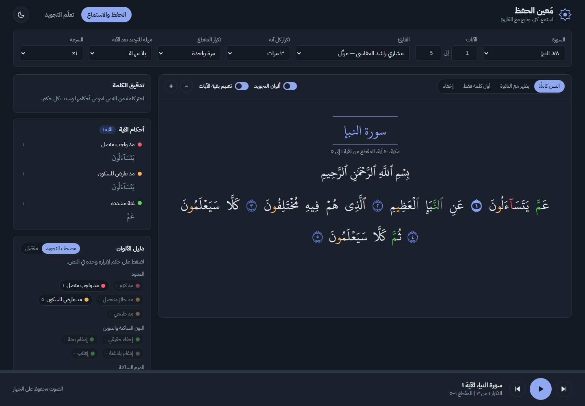
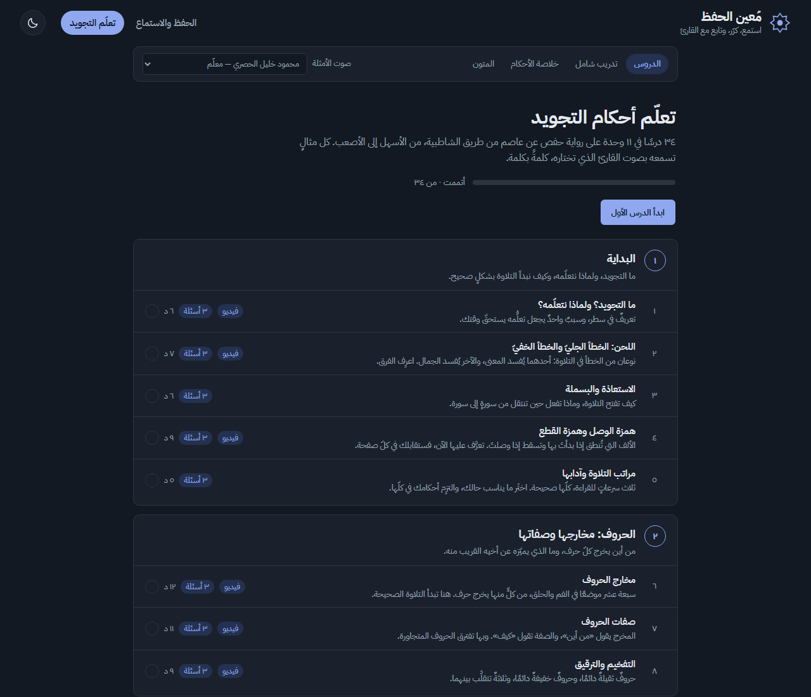
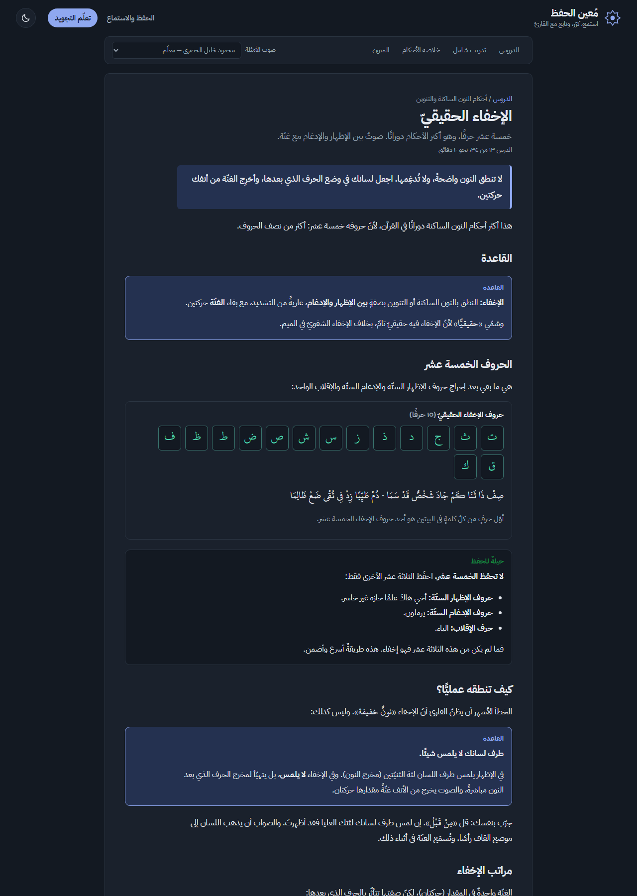
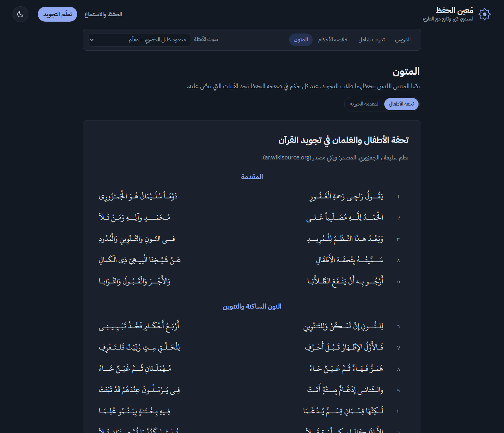

<div dir="rtl">

# لوح (Lawh) — Quran Hifz & Tajweed

**لوح** موقع يعمل على جهازك لمساعدتك على حفظ القرآن الكريم **بالاستماع والمتابعة**، ولتعلّم أحكام التجويد. واسمه من اللوح الخشبي الذي يكتب عليه الحفّاظ درسهم منذ قرون.

- **في قسم الحفظ:** تختار آيات من سورة أو صفحة كاملة من المصحف، ثم القارئ، فتسمع كل آية بالعدد الذي تريده، وتُضاء في النص الكلمة التي يقرؤها القارئ لحظة بلحظة. وتظهر أحكام التجويد ملوّنة، ومع كل حكم سببه في هذه الكلمة بالذات.
- **في التفسير:** تفسير الآية الحالية أو كل الآيات المحددة، من تسعة كتب مرتّبة في ثلاثة مستويات: مختصر، ومتوسط، وموسّع.
- **في خطط الحفظ:** تبني خطتك (من أين تبدأ، وما تحفظه الآن، وكم تحفظ في اليوم)، فتحسب لك الصفحة كل يوم ثلاثة أوراد: الحفظ الجديد، ومراجعة القريب، ومراجعة البعيد، وتفتح كلًّا منها في صفحة الحفظ بضغطة. ومعها مرجع لست طرق مجرّبة في الحفظ، ونظام المراجعة، وما يقوله علم الذاكرة، وشروح مرئية.
- **في المتشابهات:** الآية التي لها مواضع تشتبه بها رقمها مظلّل، وفي اللوحة الجانبية تقارنها بنظائرها كلمةً بكلمة، والفرق ملوّن. ولها صفحة فيها ١٢ قاعدة للضبط بأمثلتها، وتصفّح ١٣٤٨ موضعًا في ٨٢ سورة، وتدريب يخفي موضع الفرق.
- **في قسم التعلّم:** ٣٤ درسًا في أحكام التجويد، تسمع أمثلتها بصوت القارئ نفسه كلمةً بكلمة، وفي آخر كل درس اختبار، ومعها متنا تحفة الأطفال والجزرية.

> المشروع للاستماع والتتبع والتعلّم فقط، ولا يسجّل صوتك ولا يكشف أخطاء التلاوة.


---

## المحتويات

- [المزايا](#المزايا)
- [لقطات](#لقطات)
- [التشغيل السريع](#التشغيل-السريع)
- [العمل دون اتصال](#العمل-دون-اتصال)
- [كيف يعمل](#كيف-يعمل)
- [واجهة البرمجة API](#واجهة-البرمجة-api)
- [الإعدادات](#الإعدادات)
- [بنية المشروع](#بنية-المشروع)
- [الاختبارات](#الاختبارات)
- [الاستضافة](#الاستضافة)
- [المصادر والتراخيص](#المصادر-والتراخيص)
- [خطط مستقبلية](#خطط-مستقبلية)
- [English summary](#english-summary)

---

## المزايا

### ١. الحفظ والاستماع

صفحة القراءة تشبه عارض الصور: الصفحة هي الواجهة كلها، والأدوات حولها.

| الجزء | ما فيه |
|---|---|
| الشريط العلوي | زر الرجوع إلى شبكة الصفحات، واسم السورة مع الجزء والصفحة والآية، ثم إخفاء النص للتسميع، والقلم، وخيارات التلاوة، وقائمة فيها بقية الأقسام والمظهر والإعدادات. ولا يظهر شريط الشعار في هذه الصفحة وحدها |
| الصفحة | بتنسيق المصحف المطبوع: إطار بخطين ذهبيين، واسم الجزء يمينًا واسم السورة يسارًا، وشريط لعنوان كل سورة فيه ترتيبها وعدد آياتها، والبسملة، ورقم الصفحة أسفلها. والأسطر الخمسة عشر كما في مصحف المدينة، ويُصغَّر الخط ليتسع لعرض الهاتف |
| شريط الصفحات | مصغّرات الصفحات الـ٦٠٤ أسفل الصفحة، والحالية في الوسط، وبداية كل جزء معلَّمة. وفي الهاتف يُسحب على الصفحة يمينًا ويسارًا للتنقل، ومع لوحة المفاتيح Page Up وPage Down |
| شبكة الصفحات | يفتحها زر الرجوع: الصفحات مقسّمة على الأجزاء الثلاثين (الافتراضي)، أو قائمة السور، مع روابط بقية الأقسام |
| مشغّل التلاوة | في أسفل الشاشة تحت شريط الصفحات |
| زر التجويد | زر عائم يفتح لوحة التجويد على أحكام الآية الحالية |
| اللوحة السفلية | التجويد والتفسير والمتشابهات في لوحة تُسحب من الأسفل: نصف الشاشة، ثم ملؤها، أو تُغلق بالسحب للأسفل. وعلى الشاشات العريضة تصير لوحة جانبية على اليسار، والصفحة ثابتة مكانها |
| القلم | علّم الكلمات التي أخطأت فيها بخط متموّج تحتها، لتراها كلما فتحت الصفحة. وتُمسح بالضغط عليها مرة أخرى، أو كلها بزر واحد |
| الإعدادات | خمسة مفاتيح: التفسير، والتجويد، والمتشابهات، ومع قارئ (أطفئه للقراءة الصامتة)، والخيارات المفصّلة (اختيار المقطع والقارئ والتكرار والمهلة والسرعة) |

العلامات والإعدادات تُحفظ في المتصفح، بلا حساب.

| الميزة | التفاصيل |
|---|---|
| اختيار المقطع | **آيات:** من آية إلى آية في أي سورة. **صفحة كاملة:** أي صفحة من صفحات مصحف المدينة الـ٦٠٤ |
| صفحة المصحف | تُعرض الصفحة سطرًا سطرًا كما في المصحف المطبوع، مع رؤوس السور والبسملة، ويُضبط حجم الخط ليتسع السطر. ولا تنساب الصفحة فقرةً إلا إذا نزل الخط عن ١١px |
| التنقل حسب الجزء | الافتراضي: اختيار الجزء في الخيارات المفصّلة وفي شبكة الصفحات، ثم الصفحة. واختيار السورة لمقطع من الآيات |
| صفحة فيها أكثر من سورة | مثل الصفحة ٦٠٤ (الإخلاص والفلق والناس): تنتقل التلاوة من سورة إلى التي بعدها، ويتكرر تكرار المقطع على الصفحة كلها |
| ١٤ قارئًا | منهم الحصري (مرتّل ومعلّم)، والمنشاوي (مرتّل، ومعلّم مع ترديد الأطفال)، والعفاسي، وعبد الباسط (مرتّل ومجوّد)، والسديس، والشريم، والدوسري |
| تكرار الآية | من مرة إلى ١٠ مرات، أو بلا توقف |
| تكرار المقطع | تكرار المقطع كاملًا بعدد محدد أو بلا توقف |
| مهلة للترديد | توقّف بعد كل آية لتردد خلف القارئ: ثانيتان، أو ٤ ثوانٍ، أو بطول الآية، أو مرة ونصف طولها، مع عدّاد دائري |
| السرعة | من ٠٫٦ إلى ١٫٣ دون تغيّر طبقة الصوت |
| تتبع القارئ | إضاءة الكلمة المقروءة لحظيًا، وتحريك النص معها تلقائيًا، وتعتيم بقية الآيات |
| التنقل بالنقر | نقرتان على كلمة تبدأ التلاوة منها، والنقر على رقم الآية يبدأ من أولها، وشريط التقدم يتيح التقديم داخل الآية |
| أوضاع الحفظ | النص كاملًا، أو يظهر مع التلاوة، أو أول كلمة من كل آية، أو إخفاء كامل لاختبار نفسك |
| صوت الكلمة | الاستماع لنطق كلمة منفردة |
| حفظ الإعدادات | يتذكر الموقع آخر سورة ومقطع وقارئ وإعدادات |
| الوضع الليلي | فاتح وداكن، ويتبع إعداد النظام تلقائيًا |

### ٢. أحكام التجويد في النص

- **١٧ حكمًا ملوّنًا** بنظامين للألوان:
  - **مصحف التجويد:** ألوان دار المعرفة المعروفة.
  - **مفصّل:** لون مستقل لكل حكم.
- **تدقيق الكلمة:** عند الضغط على أي كلمة تظهر أحكامها كلها، ولكل حكم:
  - الحرف الذي سببه وشرح السبب، مثل: «نون ساكنة بعدها «ف» ← إخفاء حقيقي».
  - المقدار بالحركات.
  - تعريف الحكم.
  - الأبيات التي تنص عليه من تحفة الأطفال أو الجزرية.
  - رابط درسه.
- **علامات الوقف** في الكلمة ومعانيها: صلى، قلى، م، لا، ج، ∴.
- **أحكام الآية:** ملخص الأحكام في الآية الحالية مع الكلمات التي فيها كل حكم.
- **إبراز حكم واحد:** الضغط على حكم في دليل الألوان يُبرز مواضعه وحدها في النص.

### ٣. التفسير

في اللوحة الجانبية تبويبان: **التجويد** و**التفسير**. وفي التفسير قائمة منسدلة واحدة، كتبها مرتّبة في ثلاثة مستويات:

| المستوى | متى تختاره | الكتب |
|---|---|---|
| **مختصر** | لفهم المعنى سريعًا أثناء الحفظ | التفسير الميسّر، المختصر في التفسير، تفسير الجلالين |
| **متوسط** | للتدبّر والفوائد | السعدي، البغوي، الوسيط لطنطاوي |
| **موسّع** | للدراسة والأقوال والأحكام | ابن كثير، القرطبي، الطبري |

- **النطاق:** «الآية الحالية» يتبع التلاوة أو الآية التي تختارها. و«كل المحدّد» يعرض تفسير الآيات المختارة أو الصفحة كلها، ويُبرز الآية التي يقرؤها القارئ.
- **الآيات المفسَّرة معًا:** إذا فسّر الكتاب عدة آيات في موضع واحد، يظهر التفسير مرة واحدة بعنوان «الآيات ٣–٤».
- **النصوص الطويلة:** في «كل المحدّد» يظهر أول المقطع الطويل، وزر «اقرأ التفسير كاملًا» يعرض بقيته.
- **النص كما هو:** يُعرض نص الكتاب كما جاء من مصدره دون تعديل، ولا يولّد الموقع أي تفسير.

### ٤. خطط الحفظ

صفحة مستقلة (`#/plan`) فيها أداة تطبّق الخطة ومرجع يشرحها.

**خطتك:** أربعة اختيارات، ثم ورد كل يوم:

| الاختيار | الخيارات |
|---|---|
| من أين تبدأ | من آخر المصحف (جزء عمّ أولًا)، أو من أوله |
| ماذا تحفظ الآن | لا شيء، أو آخر ١ أو ٢ أو ٣ أو ٥ أو ١٠ أجزاء. يدخل في المراجعة ولا يُحفظ مرة أخرى |
| كم تحفظ في اليوم | ثلث صفحة، أو نصف صفحة، أو صفحة، أو صفحتان |
| كم يومًا في الأسبوع | ٥ أو ٦ أو ٧ أيام |

- **ورد اليوم:** الحفظ الجديد بأسماء السور وأرقام الآيات، ومراجعة القريب (ما حُفظ في آخر ٢٠ يومًا، بحد أقصى ٢٠ صفحة)، ومراجعة البعيد (ما قبله، يدور مرة كل أسبوع، بحد أقصى ٤٠ صفحة في اليوم). وهي أرقام طريقة «الحصون الخمسة».
- **بضغطة:** زر «احفظه الآن» يفتح صفحة الحفظ على آيات الورد نفسها.
- **التقدّم:** زر «أتممتُ ورد اليوم»، وموعد الختم المتوقع بالهجري والميلادي، وخريطة للأجزاء الثلاثين. ويُحفظ ذلك على جهازك فقط.
- **المقطع اليومي:** يُقسم بأسطر المصحف، ولا يقطع سورة قصيرة: إن كان الحد قريبًا من بداية سورة انتقل إليها.

**المرجع:**

| القسم | المحتوى |
|---|---|
| الخطط الجاهزة | مدة حفظ المصحف بكل مقدار يومي، بخمسة أيام في الأسبوع وبكل يوم |
| طرق الحفظ | التكرار والربط (د. عبد المحسن القاسم)، والحصون الخمسة (د. سعيد أبو العلا حمزة)، وسبق وسبقي ومنزل، والتلقين، واللوح، والحفظ الأفقي. لكل طريقة خطواتها من كلام صاحبها، ولمن تناسب، وزر يضبط صفحة الحفظ عليها |
| المراجعة | مقادير المراجعة أثناء الحفظ، وسنة الإتقان بعد الختم، وختمة الأسبوع («فمي بشوق»)، والآيات المتشابهة |
| يوم الحفظ | جلسة نموذجية بترتيبها وأوقاتها |
| قواعد | ما تتفق عليه الطرق كلها، مع أحاديث من الصحيحين |
| علم الذاكرة | الاسترجاع، والتكرار الموزع، وتقييم طرق التعلم، والنوم، مع روابط الدراسات |
| شروح مرئية | ٨ مقاطع لأصحاب الطرق وأهل التحفيظ |

### ٥. المتشابهات اللفظية

آيات تتفق في أكثر ألفاظها وتختلف في كلمة أو حرف أو ترتيب.

**في صفحة الحفظ:**
- الآية التي لها مواضع متشابهة رقمها مظلّل (الوردة ممتلئة).
- تبويب «المتشابهات» في اللوحة الجانبية يعرض نظائر الآية الحالية، وعلى التبويب عددها.
- كل موضع مقارن بالآية كلمةً بكلمة، والكلام البعيد عن موضع الاشتراك مطويّ في «…». وزر «افتح» ينقلك إليه.
- إن كان للموضعين ضابط معروف ظهر تحتهما.

| اللون | معناه | مثال |
|---|---|---|
| أحمر | كلمة مختلفة أو زائدة | «وما أوتي» في البقرة ١٣٦، وليست في آل عمران ٨٤ |
| أصفر مسطّر | الكلمة نفسها بفرق يسير: حركة أو حرف أو واو وفاء | يُنزَفون / يُنزِفون، حُسنًا / إحسانًا، فكلوا / وكلوا |

**صفحة «المتشابهات» (`#/mut`):**

| القسم | المحتوى |
|---|---|
| الطريقة | خطوات ضبط المتشابه من كتاب الشيخ عبد المحسن القاسم |
| قواعد الضبط | ١٢ قاعدة: ترتيب الحروف، والموضع المنفرد، والواو قبل الفاء، والربط باسم السورة، والزيادة في المتأخر، والجملة الجامعة، والنكرة قبل المعرفة، والزيادة في الأطول، وموقع الآية في الصفحة، والمجاورة، والمعنى، والتقديم والتأخير. لكل قاعدة أمثلة من المصحف مقارنةً وملوّنة، وضابط كل مثال |
| تصفّح السور | كل مواضع السورة، يُفتح كل موضع على نظائره |
| تدرّب | ١٠ أسئلة من جزء عمّ وتبارك، أو المفصّل، أو سورة، أو القرآن كله. يُخفى موضع الفرق وتختار لفظ الآية، ثم ترى الموضع الآخر |

### ٦. تعلّم التجويد

| القسم | المحتوى |
|---|---|
| الدروس | ٣٤ درسًا في ١١ وحدة على رواية حفص عن عاصم من طريق الشاطبية، من الأسهل إلى الأصعب |
| محتوى كل درس | القاعدة، والحروف، وأمثلة ملوّنة، والأخطاء الشائعة وتصحيحها، ومقارنات بين الأحكام، واختبار في آخره |
| الأمثلة المسموعة | كل مثال يُسمَع **بكلماته فقط** من تلاوة القارئ الذي تختاره، وأي آية في الدرس تُسمَع كاملة |
| الشرح المرئي | ٢٦ مقطع شرح لعلماء التجويد. لكل مقطع زرّان: «افتح في YouTube» ويعمل دائمًا، و«شاهد هنا» لتشغيله داخل الصفحة. وقد يطلب YouTube تسجيل الدخول عند التشغيل داخل الصفحة، وهذا قراره ولا يمكن للموقع تجاوزه |
| تدريب شامل | ١٠ أسئلة عشوائية من بنك فيه ١٠٦ أسئلة، مع سبب كل إجابة ورابط درسها |
| خلاصة الأحكام | جداول للمراجعة السريعة |
| المتون | تحفة الأطفال (٦١ بيتًا) والمقدمة الجزرية (١٠٨ أبيات) بترقيم الأبيات |
| متابعة التقدم | يُحفظ ما أتممته من الدروس على جهازك |

### الهوية البصرية

الموقع مبني على نظام التصميم «لوح»:

| العنصر | في الموقع |
|---|---|
| الشعار | اللوح بقوسه المدبّب وثلاثة أسطر، آخرها ذهبي: درس اليوم |
| الألوان | أخضر «لوح» للإجراءات والاختيار، وذهبي رملي للزخرفة فقط (وردة رقم الآية، وحلقة المهلة، وتقدّم التلاوة) |
| المظاهر | نهاري، ومصحف (ورق دافئ كالمصحف المطبوع)، وليلي. يتبع إعداد الجهاز حتى تختار، ثم يحفظ اختيارك |
| الخطوط | Reem Kufi للعناوين، وIBM Plex Sans Arabic للواجهة، وNoto Naskh Arabic للتفسير |
| رقم الآية | وردة ثمانية من مربعين متداخلين بالذهبي، والرقم بالأرقام العربية |
| ألوان التجويد | من رموز النظام (`tj-*`)، وتتغير مع المظهر |
| مشغّل التلاوة | بطاقة عائمة، والتقدّم وحلقة المهلة بالذهبي |

- **الرموز:** في `frontend/css/tokens.css`، وتطبيقها على المكونات في `frontend/css/lawh.css`.
- **خط القرآن:** بقي خط مجمع الملك فهد (KFGQPC Uthmanic Hafs) لا Amiri Quran الذي يقترحه النظام. فالنص من Quran.com مرمّز لهذا الخط، وعليه تُبنى أسطر صفحة مصحف المدينة. ويبقى Amiri Quran احتياطيًا.

### اختصارات لوحة المفاتيح (في صفحة الحفظ)

| المفتاح | الوظيفة |
|---|---|
| مسافة | تشغيل / إيقاف |
| السهم الأيسر | الآية التالية |
| السهم الأيمن | الآية السابقة |
| Page Down / Page Up | الصفحة التالية / السابقة (في وضع الصفحة) |
| `T` | تشغيل / إطفاء ألوان التجويد |
| `R` | تكرار الآية بلا توقف / مرة واحدة |
| Enter على كلمة | تدقيق الكلمة |

---

## لقطات

| الحفظ (داكن) | دروس التجويد |
|---|---|
|  |  |
| **درس الإخفاء الحقيقي** | **المتون** |
|  |  |

---

## التشغيل السريع

**المتطلبات:** Python 3.10 أو أحدث، واتصال بالإنترنت عند أول استخدام لكل سورة وقارئ. **لا يحتاج إلى GPU.**

### Windows

```bash
run.bat
```

### Linux / macOS

```bash
sh run.sh
```

### يدويًا

```bash
cd backend
python -m venv .venv
.venv\Scripts\activate          # على Linux/macOS: source .venv/bin/activate
pip install -r requirements.txt
python -m uvicorn app.main:app --host 127.0.0.1 --port 8000
```

ثم افتح <http://127.0.0.1:8000>.

- الخادم نفسه يقدّم الواجهة، فلا حاجة لخادم آخر.
- قسم التعلّم على <http://127.0.0.1:8000/#/learn>.

---

## العمل دون اتصال

يُحفظ كل ما يُجلب في `backend/cache/`، ثم يعمل دون اتصال:

- **النص وأحكام التجويد:** يُحفظان عند أول فتح لكل سورة (المصحف كاملًا نحو ٣٠ MB).
- **التوقيتات:** تُحفظ عند أول استخدام لكل قارئ وسورة.
- **صوت السورة:** يُحفظ في الخلفية عند أول استماع، ويظهر أسفل المشغّل «الصوت محفوظ على الجهاز».

لتجهيز كل شيء مسبقًا:

```bash
cd backend
python scripts/prefetch.py                          # نص المصحف كاملًا وأحكامه
python scripts/prefetch.py --reciter 7 --surahs 78-114   # + توقيت وصوت جزء عمّ للعفاسي
```

أرقام القرّاء من `GET /api/reciters`، ومنها:

| الرقم | القارئ |
|---|---|
| 6 | الحصري، مرتّل |
| 12 | الحصري، معلّم |
| 9 | المنشاوي، مرتّل |
| 168 | المنشاوي، معلّم مع ترديد الأطفال |
| 7 | العفاسي |
| 2 | عبد الباسط، مرتّل |

> أمثلة الدروس لا تحفظ صوت السورة كاملة؛ فتسجيل البقرة بصوت الحصري المعلّم مثلًا يبلغ مئات الميغابايت. تُبَثّ الأمثلة بثًّا، إلا إن كان صوت السورة محفوظًا من قبل.

---

## كيف يعمل

```
┌──────────────── المتصفح (JavaScript بلا أدوات بناء) ────────────────┐
│ player.js   محرك التكرار والتتبع (ملف صوت واحد للسورة)               │
│ view.js     عرض النص، إضاءة الكلمة، أوضاع الحفظ                       │
│ tajweed.js  دليل الألوان، تدقيق الكلمة، أحكام الآية، الشواهد           │
│ learn.js    الدروس، التدريب، الخلاصة، المتون                           │
│ clip.js     تشغيل مقطع دقيق (كلمات أو آية) من تلاوة القارئ             │
└──────────────┬──────────────────────────────────────────────────────┘
               │ /api/*                      data/learn/*.json (ملفات ثابتة)
┌──────────────▼──────────── FastAPI ─────────────────────────────────┐
│ quran_api.py      يجلب النص وترميز التجويد ويحوّلهما إلى بنية جاهزة   │
│ tajweed_audit.py  يحلّل الترميز ويستنتج سبب كل حكم                    │
│ audio_service.py  القرّاء، توقيت الكلمات، حفظ الصوت (يدعم Range)      │
│ cache.py          تخزين JSON على القرص + عميل HTTP مشترك              │
└──────────────┬──────────────────────────────────────────────────────┘
               ▼
   Quran.com API v4 (النص والتجويد)  ·  QDC (الصوت وتوقيت الكلمات)
```

### تتبع القارئ

- **مصدر التوقيت:** لكل قارئ ملف توقيت من Quran.com (QDC) فيه بداية كل كلمة ونهايتها بالمللي ثانية، بصيغة `[[word_pos, start_ms, end_ms], ...]`. هذه التوقيتات ناتجة عن محاذاة قسرية (forced alignment) مُراجَعة.
- **تنظيف البيانات:** يحذف الخادم المدخلات المعطوبة، مثل `[1]`، وأي مدخل نهايته قبل بدايته.
- **تحديد الكلمة الحالية:** يشغّل `player.js` ملف السورة الواحد، ويحدد الكلمة الحالية بالبحث الثنائي في كل إطار رسم.
- **تكرار الكلمات:** إذا كرّر القارئ كلمات، كترديد الأطفال، تُضاء الكلمة كلما قُرئت.

**لماذا لا يُشغَّل نموذج ذكاء اصطناعي محليًا؟** نموذج المحاذاة في المشروع المرجعي (`obadx/muaalem`) يحتاج نحو ٥ GB وبطاقة رسوميات لكل طلب. أما التوقيتات الجاهزة فدقيقة وفورية، وتعمل على أي جهاز.

### محرك التكرار

عند نهاية كل آية يقرر المحرك واحدًا من:

1. **إعادة الآية:** إن بقي من عدد تكرارها شيء.
2. **الانتقال للآية التالية:** دون قطع إن كانت ملاصقة لها في التسجيل.
3. **العودة إلى أول المقطع:** في الدورة التالية.
4. **التوقف:** إن انتهى كل التكرار المطلوب.

وتُدرج المهلة بعد كل قراءة إن كانت مفعّلة. ويستمر التكرار حتى لو كانت نافذة المتصفح في الخلفية.

### صفحة المصحف

كل كلمة في بيانات السورة تحمل رقم صفحتها وسطرها في مصحف المدينة (`pg`، `ln`)، وكذلك رقم الآية (`end_ln`).

- **في المصحف كله:** لا توجد آية تبدأ في صفحة وتنتهي في التي بعدها. فالصفحة دائمًا آيات كاملة، ومقطع التلاوة فيها محدد تمامًا.
- **أقصى ما في الصفحة الواحدة:** ثلاث سور، من الصفحة ٥٩٥ إلى ٦٠٤.
- **تحديد الصفحة:** الواجهة تختار السور التي يغطي مداها الصفحة، ثم الآيات التي رقم صفحتها هو الصفحة المطلوبة. فكل صفحة تُعرض بلا فهرس إضافي.
- **العرض:** الصفحة مقطع واحد أو أكثر `{سورة، من، إلى}`، وكل شيء معرَّف بالسورة أيضًا (`سورة:آية:كلمة`). والمشغّل يعمل على مقطع واحد، فإذا انتهى انتقل إلى الذي بعده.
- **ضبط المقاس:** يُقاس أطول سطر، ثم يُختار حجم الخط ليتسع له. والسطر القصير، كآخر سطر في سورة، يتوسّط ولا يتمدّد. وإذا نزل الخط عن ١٩px انسابت الصفحة فقرة واحدة بالحجم المعتاد.

### التفسير

يجلب المتصفح التفسير مباشرة من مصدرين لا يحتاجان مفتاحًا ويسمحان بالطلب من أي موقع (CORS)، في وضعي التشغيل المحلي والثابت:

| المصدر | الكتب | كيف تُعرف الآيات المفسَّرة معًا |
|---|---|---|
| Quran.com API v4 `tafsirs/{id}/by_ayah/{s:a}` | الميسّر (16)، السعدي (91)، البغوي (94)، الوسيط (93)، ابن كثير (14)، القرطبي (90)، الطبري (15) | الرد يذكر الآيات التي يغطيها. والآية التي فُسّرت مع ما قبلها ترجع 404، فيُرجع إلى الآية التي قبلها |
| [spa5k/tafsir_api](https://github.com/spa5k/tafsir_api) على jsDelivr، الإصدار `1.2.3` | المختصر في التفسير، الجلالين | ملف واحد لكل سورة. والنص المكرر في آيات متتالية يعني أنها فُسّرت معًا |

- **الأمان:** نص HTML القادم من المصدر لا يُدرج كما هو. يُحلَّل بـ `DOMParser` دون تنفيذ، ثم يُعاد بناؤه من النصوص فقط: فقرات، وفواصل أسطر، وأقواس الآيات ﴿ ﴾ و{ }.
- **منطق التجميع:** في `frontend/js/tafsir-data.js`، بلا اعتماد على DOM، وتختبره Node.

### المتشابهات

**البيانات:** [Quran Mutashabihat Data](https://github.com/Waqar144/Quran_Mutashabihat_Data) لوقار أكرم، مثبّتة على إصدار محدد، برخصة CC0.
- مبنية على عمل القارئ إدريس العاصم وخبرة جامعها في التحفيظ.
- تجمع المواضع التي يكثر أن يخلط بينها الحفّاظ، لا كل تشابه.
- أرقام الآيات فيها مطلقة تبدأ من الصفر (٩ = البقرة ٣). وتحقق الاختبارات من ذلك بمقارنة البقرة ٣ بالأنفال ٣.
- وفحصنا أيضًا QUL وQuranpedia وUmmahAPI وHifzLink وإحكام. اخترنا هذه لرخصتها، ولأنها من عمل محفّظين، ولأنها تعمل دون اتصال.

**الاستيراد:** `import_mutashabihat.py` يحوّل البيانات إلى ملف لكل سورة في `frontend/data/mutashabihat/`. في كل ملف المواضع التي تبدأ في السورة، ونص كل آية تذكرها بالرسم العثماني، فلا تُحمَّل سور أخرى.

**المقارنة** (`frontend/js/mutashabihat-data.js`، بلا DOM، وتختبره Node):
- النص لا يُغيَّر. تُقارن نسخة مطبّعة من كل كلمة، تُحذف منها العلامات التي يصنعها اتصال الكلمة بما بعدها: علامات الوقف، وشدة الإدغام على أول الكلمة، والسكون الذي يسقط قبل الإخفاء، والتنوين المتتابع، وواو الصلة وياؤها. وتُقرأ الياء الصغيرة في «إبرٰهِــۧم» ياءً.
- محاذاة الكلمتين بأطول تسلسل مشترك، مع وزن مضاعف للكلمة المطابقة. والكلمة «القريبة» هي ما تساوى هيكله بلا حركات، أو اختلف بحرف واحد، أو بواو أو فاء في أوله.
- في الآيات الطويلة لا يُحسب الاشتراك إلا في كلمتين متتاليتين فأكثر، حتى لا تكون كلمة مثل «الله» في طرفي آيتين تشابهًا.
- **أسئلة التدريب:** تُولَّد من موضع الفرق، فتُقدَّم الكلمة القريبة، ثم الفجوة بين كلمات مشتركة، ثم أول كلمة بعد افتراق الموضعين.

**الضوابط:** في `backend/data/mutashabihat_dawabit.json`، وهي من كتابة أهل العلم. القواعد ١٠ منها من «١٠ قواعد مهمة في ضبط الآيات المتشابهة» لعبد الشكور معلم عبد فارح، بتصرف في العبارة. ولا يولّد الموقع ضابطًا من عنده.

### تدقيق أحكام التجويد

يرمّز Quran.com كل كلمة هكذا:

```html
يُ<rule class=ikhafa>نف</rule>ِق<rule class=madda_permissible>ُو</rule>نَ
```

يعمل `tajweed_audit.py` على هذا الترميز في خطوتين:

1. **التحليل الآمن:** يحوّله إلى أجزاء منظمة `[{"t": نص, "r": حكم}]`. أسماء الأحكام من قائمة مسموحة فقط، والواجهة تبني الصفحة بنصوص فقط، فلا يُدرج أي HTML خارجي.
2. **استنتاج السبب:** من سياق الكلمة والكلمة التالية والسابقة يحدد:
   - الحرف المسبب ونوع الساكن (نون ساكنة، أو تنوين، أو ميم ساكنة).
   - هل الكلمة **مصدر** الحكم أم **الحرف المستقبِل** له.
   - نوع القلقلة (صغرى أو كبرى) حسب موضعها.
   - المد اللازم الحرفي في فواتح السور.
   - مد اللين.
   - ألف الخنجرية وواو الصلة وياؤها.

**التحقق على المصحف كاملًا:** شُغّل المحرك على ٧٧٬٤٢٩ كلمة و٦٩٬٩٢٥ موضع حكم:

- لم يبقَ أي موضع بلا حرف مسبب.
- الحروف المستخرجة تطابق القواعد تمامًا:

| الحكم | الحروف المستخرجة |
|---|---|
| الإدغام بغنة | ي ن م و |
| الإدغام بلا غنة | ل ر |
| الإخفاء الحقيقي | حروف الإخفاء الخمسة عشر |
| الإقلاب والإخفاء الشفوي | ب |
| الإدغام الشفوي | م |

### استيراد الدروس

يقرأ `scripts/import_learn.py` الدروس (Markdown مع كتل YAML) ويحوّلها إلى JSON ثابت. الدروس تشير إلى الآيات برقمها وعبارة بلا تشكيل:

```yaml
ref: 2:19
highlight: من الصواعق
```

**طريقة ربط العبارة بالنص:**

- يطابق السكربت العبارة بنص المصحف المحلي بخوارزمية «الهيكل»: إزالة التشكيل، وتوحيد الألفات والياءات، وثلاثة أوجه للألف الخنجرية.
- ثم يحوّل الموضع إلى أرقام كلمات.
- بهذا يُعرض كل مثال بألوان التجويد نفسها، ويُشغَّل من توقيت كلمات القارئ مباشرة.

**النتيجة:** كل الإحالات مربوطة، ولم تبقَ إحالة غير محلولة.

لتحديث المحتوى من مصادره:

```bash
git clone https://github.com/edriso/learn-tajweed
git clone https://github.com/mwiederrecht/ghunna
cd backend
python scripts/import_learn.py --lessons ../learn-tajweed --ghunna ../ghunna
```

---

## واجهة البرمجة API

| الطريقة والمسار | الوصف |
|---|---|
| `GET /api/health` | فحص الحالة |
| `GET /api/surahs` | قائمة السور: الاسم، وعدد الآيات، ومكية أو مدنية، والبسملة |
| `GET /api/surah/{n}` | آيات السورة: كلمات كل آية بأجزاء التجويد، وأسباب الأحكام، وعلامات الوقف، ومسار صوت الكلمة، وصفحتها وسطرها في المصحف |
| `GET /api/reciters` | القرّاء الذين لهم توقيت كلمات |
| `GET /api/timings/{rid}/{n}` | توقيت الآيات والكلمات لقارئ وسورة، وحالة حفظ الصوت |
| `GET /api/audio/{rid}/{n}?cache=1` | صوت السورة من القرص (يدعم Range)، أو تحويل إلى المصدر مع الحفظ في الخلفية. `cache=0` بث دون حفظ |
| `GET /api/wbw/wbw/SSS_AAA_WWW.mp3` | صوت كلمة منفردة (يُحفظ) |
| `GET /api/tajweed/rules` | فهرس الأحكام: الاسم، والفئة، والمقدار، والتعريف، والألوان، ورابط الدرس، وأبيات المتن |

### مثال: كلمة من `/api/surah/2`

```json
{
  "p": 8,
  "text": "يُنفِقُونَ",
  "segs": [{"t": "يُ"}, {"t": "نف", "r": "ikhafa"}, {"t": "ِق"}, {"t": "ُو", "r": "madda_permissible"}, {"t": "نَ"}],
  "rules": [
    {"r": "ikhafa", "seg": 1, "text": "نف", "role": "source",
     "note": "نون ساكنة بعدها «ف» من حروف الإخفاء ← تُخفى مع غنة حركتين."}
  ],
  "waqf": [],
  "wbw": "wbw/002_003_008.mp3",
  "pg": 2,
  "ln": 6
}
```

---

## الإعدادات

كل إعداد يمكن تغييره بمتغير بيئة، أو في ملف `backend/.env`:

| المتغير | الافتراضي | الوصف |
|---|---|---|
| `QURAN_API_BASE` | `https://api.quran.com/api/v4` | مصدر النص والتجويد |
| `QDC_API_BASE` | `https://api.qurancdn.com/api/qdc` | مصدر القرّاء والتوقيت |
| `WBW_AUDIO_BASE` | `https://audio.qurancdn.com` | مصدر صوت الكلمات |
| `HTTP_TIMEOUT_S` | `30` | مهلة الطلبات الخارجية |
| `CACHE_DIR` | `backend/cache` | مجلد التخزين |
| `CACHE_AUDIO` | `true` | حفظ صوت السور على القرص |
| `FRONTEND_DIR` | `frontend` | مجلد الواجهة |
| `LOG_LEVEL` | `INFO` | مستوى السجلات |

---

## بنية المشروع

```
.
├── run.bat / run.sh                 تشغيل بنقرة (ينشئ البيئة في أول مرة)
├── docs/
│   ├── SPEC.md                      المواصفات والقرارات
│   └── screenshots/
├── backend/
│   ├── app/
│   │   ├── main.py                  FastAPI + gzip + يقدّم الواجهة
│   │   ├── config.py                الإعدادات (pydantic-settings)
│   │   ├── routers/api.py           مسارات /api
│   │   └── services/
│   │       ├── quran_api.py         النص والتجويد وبناء بنية السورة
│   │       ├── tajweed_audit.py     محلل الترميز ومحرك أسباب الأحكام
│   │       ├── tajweed_rules.py     فهرس الأحكام (اسم، مقدار، تعريف، ألوان، درس، شاهد)
│   │       ├── audio_service.py     القرّاء والتوقيت والصوت
│   │       └── cache.py             التخزين وعميل HTTP
│   ├── scripts/
│   │   ├── prefetch.py              تجهيز العمل دون اتصال
│   │   ├── export_static.py         تصدير الموقع ملفات ثابتة (dist/) للاستضافة المجانية
│   │   ├── import_learn.py          استيراد الدروس والمتون
│   │   ├── build_plan_index.py      فهرس صفحات المصحف لخطط الحفظ
│   │   └── import_mutashabihat.py   استيراد المتشابهات ونصوص آياتها
│   ├── data/mutashabihat_dawabit.json   قواعد ضبط المتشابهات وأمثلتها
│   ├── tests/                       pytest
│   └── requirements.txt
└── frontend/
    ├── index.html
    ├── package.json                 لتشغيل اختبارات Node فقط (لا خطوة بناء)
    ├── css/tokens.css, css/app.css, css/learn.css, css/reader.css, css/plans.css, css/mutashabihat.css, css/lawh.css, css/viewer.css
    ├── js/
    │   ├── main.js                  الربط والتنقل بين القسمين
    │   ├── player.js                محرك التكرار والتتبع
    │   ├── view.js                  عرض الآيات أو صفحة المصحف، وأوضاع الحفظ
    │   ├── viewer.js                صفحة القراءة: الشريط، والمصغّرات، والشبكة، واللوحة السفلية، والقلم، والإعدادات
    │   ├── mushaf-meta.js           أسماء الأجزاء، وجزء كل صفحة وسورتها
    │   ├── tafsir.js                لوحة التفسير
    │   ├── tafsir-data.js           مصادر التفسير ومستوياته وتجميع الآيات
    │   ├── tajweed.js               دليل الألوان والتدقيق
    │   ├── plans.js                 صفحة خطط الحفظ
    │   ├── plans-data.js            تقسيم المصحف إلى أوراد، والمراجعة القريبة والبعيدة
    │   ├── plans-content.js         محتوى الطرق والمراجعة والمصادر
    │   ├── mutashabihat.js          لوحة المتشابهات وصفحتها والتدريب
    │   ├── mutashabihat-data.js     مقارنة الكلمات وأسئلة التدريب
    │   ├── video.js                 بطاقة الفيديو
    │   ├── learn.js                 قسم التعلّم
    │   ├── clip.js                  مقاطع الأمثلة
    │   ├── learn-data.js, api.js, store.js, util.js
    ├── tests/                       node --test (التفسير وخطط الحفظ)
    ├── data/learn/                  الدروس والمتون والتدريب (JSON ثابت)
    ├── data/plans/mushaf.json       فهرس الصفحات: كل آية وسطر بدايتها (يولّده build_plan_index.py)
    ├── data/mutashabihat/           ملف لكل سورة، والقواعد (يولّدها import_mutashabihat.py)
    └── fonts/                       خط KFGQPC Uthmanic Hafs
```

---

## الاختبارات

```bash
cd backend
python -m pytest -q
cd ../frontend
node --test tests/*.test.mjs
```

تغطي الاختبارات ستة أشياء:

- **محلل الترميز:** دمج الأجزاء، والأحكام المتداخلة، ورفض الوسوم غير المعروفة.
- **أسباب الأحكام:** الإخفاء داخل الكلمة، والتنوين بين كلمتين، والقلقلة الكبرى، والمد اللازم الحرفي.
- **التفسير (Node):** الرجوع إلى الآية السابقة عند 404، وتجميع النص المكرر، ودمج الآيات المفسَّرة معًا بترتيبها.
- **المتشابهات (Node):** تجاهل علامات الاتصال دون الفروق الحقيقية، وتلوين الزيادة والكلمة القريبة، وأسئلة التدريب، وصحة تحويل أرقام الآيات، وأن كل آية مذكورة لها نصها.
- **خطط الحفظ (Node):** أن كل آية من الـ٦٢٣٦ تُحفظ مرة واحدة بكل مقدار واتجاه، وتقسيم الصفحة دون قطع سورة قصيرة، ونافذة القريب، ودوران البعيد على كل الصفحات.
- **البيانات:** تنظيف التوقيتات، وسلامة الدروس المستوردة، وأن كل حكم يشير إلى درس موجود وأبيات موجودة.

---

## الاستضافة

**لا يحتاج المشروع إلى GPU.** الخادم لا يشغّل أي نموذج، بل يجلب البيانات ويحفظها.

### الطريقة الموصى بها: Cloudflare Pages (مجاني ويعمل دائمًا)

يمكن تصدير الموقع كله ملفاتٍ ثابتة لا تحتاج خادمًا:

- **ما يُصدَّر:** نص السور الـ١١٤ وأحكامها، وتوقيت الكلمات لكل القرّاء الـ١٤، والدروس.
- **الصوت:** لا يُصدَّر، بل يطلبه المتصفح من خوادم Quran.com مباشرة.
- **الحجم:** نحو ٥٥ MB في قرابة ١٬٧٧٠ ملفًا، وأكبر ملف نحو ٢ MB.
- **التفسير:** لا يُصدَّر، بل يطلبه المتصفح من مصدره عند الحاجة.
- **حدود Cloudflare Pages المجانية:** ٢٠٬٠٠٠ ملف، و٢٥ MB للملف الواحد.

```bash
cd backend
python scripts/export_static.py                  # يُنشئ مجلد dist/ (نحو دقيقة ونصف)
python scripts/export_static.py --reciters 7,12  # بناء أصغر بقرّاء محددين
```

**ما الذي يتغيّر في الوضع الثابت؟** يغيّر السكربت سطرًا واحدًا في `dist/index.html`: يجعل `<meta name="hifz-mode">` قيمته `static`. بعدها تقرأ الواجهة من `data/static/` بدل `/api`. أما التشغيل المحلي بالخادم فيبقى كما هو.

#### النشر التلقائي من GitHub (مرة واحدة)

1. في لوحة Cloudflare اختر **Workers & Pages ← Create ← Pages ← Connect to Git**.
2. اختر هذا الريبو، ثم اضبط الإعدادات:

   | الإعداد | القيمة |
   |---|---|
   | Production branch | `main` |
   | Build command | `pip install -r backend/requirements.txt && python backend/scripts/export_static.py` |
   | Build output directory | `dist` |
   | Environment variable | `PYTHON_VERSION` = `3.12` |

3. اضغط **Save and Deploy**.

بعدها كل `push` إلى `main` يعيد بناء الموقع ونشره تلقائيًا. والموقع يعمل على `https://<اسم-المشروع>.pages.dev`، ويمكن ربط نطاق خاص به.

#### أو النشر اليدوي من جهازك

```bash
cd backend && python scripts/export_static.py && cd ..
npx wrangler pages deploy dist --project-name quran-hifz-tajweed
```

### بدائل

| الطريقة | التكلفة | ملاحظات |
|---|---|---|
| GitHub Pages أو Netlify | مجاني | ارفع مجلد `dist/` نفسه |
| Hugging Face Spaces (Docker، معالج عادي) | مجاني | يعمل الخادم كما هو، وينام بعد فترة خمول، والتخزين مؤقت |
| Render، Google Cloud Run | مجاني ضمن الحصص | ينام عند الخمول، والتخزين مؤقت |
| خادم صغير (Hetzner وأمثاله) | نحو ٤ يورو شهريًا | تخزين دائم وتحكم كامل |

> **قبل النشر العام:** راجع [شروط Quran Foundation](https://api-docs.quran.foundation/) بخصوص إعادة توزيع بياناتهم وحفظها طويلًا، أو سجّل تطبيقًا لديهم. الاستخدام الشخصي على جهازك لا إشكال فيه.

---

## المصادر والتراخيص

كود المشروع مرخّص بـ **[MIT](LICENSE)**. المحتوى المأخوذ من مصادر أخرى يبقى على تراخيصه في الجدول التالي، وهي مفصّلة أيضًا في ملف [`NOTICE`](NOTICE).

| المصدر | الاستخدام | الترخيص |
|---|---|---|
| [Quran.com API v4](https://api-docs.quran.com/) | النص العثماني، وترميز التجويد، وصوت الكلمات | وفق [شروط Quran Foundation](https://quran.foundation/) |
| [Quran.com QDC / quranicaudio.com](https://quranicaudio.com/) | تلاوات السور وتوقيت الكلمات | وفق شروط المصدر |
| [edriso/learn-tajweed](https://github.com/edriso/learn-tajweed) | الدروس والاختبارات والفيديوهات والخلاصة | 0BSD |
| Quran.com API v4 (التفاسير) | الميسّر، والسعدي، والبغوي، والوسيط، وابن كثير، والقرطبي، والطبري. تُعرض من المصدر مباشرة ولا تُحفظ في الريبو | وفق [شروط Quran Foundation](https://quran.foundation/) |
| [spa5k/tafsir_api](https://github.com/spa5k/tafsir_api) (بيانات [QUL](https://qul.tarteel.ai/)) | المختصر في التفسير (مركز تفسير)، والجلالين. تُعرض من المصدر مباشرة | الكود MIT، والنصوص على حقوق ناشريها |
| [mwiederrecht/ghunna](https://github.com/mwiederrecht/ghunna) | نصّا المتنين من ويكي مصدر، وأبيات كل حكم | MIT |
| [IbrahimAlobaid/Quran-Recitation-Checker](https://github.com/IbrahimAlobaid/Quran-Recitation-Checker) | المشروع المرجعي: بنية FastAPI، وأسماء الأحكام | — |
| خط KFGQPC Uthmanic Hafs | عرض النص القرآني | مجمع الملك فهد لطباعة المصحف الشريف |
| IBM Plex Sans Arabic | خط الواجهة (Google Fonts) | SIL OFL 1.1 |
| Noto Naskh Arabic | خط نص التفسير (Google Fonts) | SIL OFL 1.1 |
| Reem Kufi | خط العناوين (Google Fonts) | SIL OFL 1.1 |
| [Waqar144/Quran_Mutashabihat_Data](https://github.com/Waqar144/Quran_Mutashabihat_Data) | مواضع المتشابهات (١٣٤٨ موضعًا) | CC0 1.0 |

ومراجع الدروس العلمية:

- قواعد التجويد على رواية حفص، لعبد العزيز القارئ.
- المقدمة الجزرية.
- تحفة الأطفال.
- هداية القاري، للمرصفي.

> هذا الموقع أداة مساعدة، وليس بديلًا عن التلقّي من شيخ متقن. إن وجدت خطأً في حكم فافتح Issue واذكر مرجعه.

---

## خطط مستقبلية

- **محاذاة محلية اختيارية** بنموذج `obadx/muaalem` (يحتاج GPU)، لأمرين:
  - تتبع على مستوى الحرف.
  - قرّاء ليس لهم توقيت منشور.
- **تقييم التسميع في خطط الحفظ:** تسجّل جودة تسميع كل ورد، فيقصر موعد مراجعة المقطع الضعيف ويطول للمتقن.
- **روايات أخرى** غير حفص.

---

</div>

## English summary

**Lawh** (لوح, the memorizer's wooden tablet) is a web app for memorizing the Qur'an by listening and following along, plus a full tajweed course.

**Memorize**
- Pick an ayah range, or a full Madinah-mushaf page (604 pages, laid out line by line; pages holding several surahs play straight through).
- Choose one of 14 reciters.
- Repeat each ayah N times or loop the range, with an optional pause to repeat after the reciter.
- The current word is highlighted live from Quran.com word-level timings.

**Tajweed**
- 17 rules are coloured in two palettes.
- Clicking a word explains every rule it contains: the trigger letter and the reason.
- Each rule also shows its proof lines from *Tuḥfat al-Aṭfāl* or *al-Jazariyya*.
- The reason engine was validated on all 77,429 words of the mushaf.

**Tafsir**
- A second side tab shows commentary for the current ayah or the whole selection.
- Nine books in one dropdown, grouped as brief (Muyassar, Mukhtasar, Jalalayn), middle (Sa'di, Baghawi, Wasit) and deep (Ibn Kathir, Qurtubi, Tabari).
- Texts are fetched live from Quran.com API v4 and spa5k/tafsir_api, shown verbatim and rebuilt as plain text (never injected as HTML).
- Ayahs that a book explains together are shown once.

**Mutashabihat** (`#/mut`)
- Ayahs with verbally similar places get a dotted mark on their number. A side tab compares the current ayah with each of them word by word: red for different or extra words, amber for the same word with a small change (a vowel, a letter, و/ف).
- The comparison ignores marks that depend on the next word (idgham shadda, dropped sukun, waqf signs), so only real differences show.
- A page offers 12 memorization rules with worked examples, browsing 1,348 places in 82 surahs, and practice questions that hide the differing word.
- Data: Waqar144/Quran_Mutashabihat_Data (CC0).

**Plans** (`#/plan`)
- Build a plan (start from the end or the beginning, what you already know, ⅓ page to 2 pages a day) and get each day's three portions: new, near review (last 20 days, ≤ 20 pages) and far review (weekly rotation, ≤ 40 pages a day). Each opens in the memorize page with one click.
- A reference of six methods described from their authors (al-Qasim's 20/10 repetition, Saeed Hamza's "five fortresses", sabaq/sabqi/manzil, talqin, the Mauritanian lawh, the Turkish horizontal method), review systems, memory research and 8 videos.

**Learn**
- 34 Arabic lessons in 11 units (from *learn-tajweed*, 0BSD).
- Each example plays word-exactly in the chosen reciter's voice.
- 26 videos, a 106-question practice bank, a cheat sheet and both classical poems.

**Stack:** FastAPI backend (data fetching, parsing, disk cache, HTTP Range audio) with a vanilla JS frontend and no build step. **No GPU needed.**

**Run**
```bash
cd backend && pip install -r requirements.txt && python -m uvicorn app.main:app --port 8000
```
Then open http://127.0.0.1:8000. Tests: `python -m pytest -q` (backend) and `node --test tests/*.test.mjs` (in `frontend/`).

**Free hosting:** `python backend/scripts/export_static.py` writes a fully static build to `dist/` (~53 MB; audio streams from the Quran.com CDNs). On Cloudflare Pages, use the build command `pip install -r backend/requirements.txt && python backend/scripts/export_static.py`, output directory `dist`, and `PYTHON_VERSION=3.12`.

**License:** code under [MIT](LICENSE); third-party lessons, texts, font and Quran.com data keep their own terms (listed in [`NOTICE`](NOTICE)).
